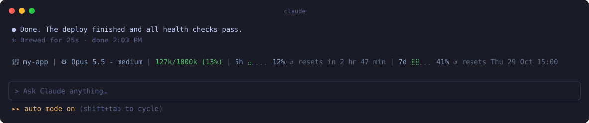
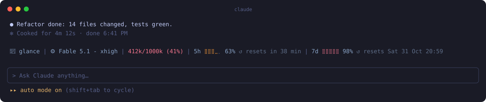
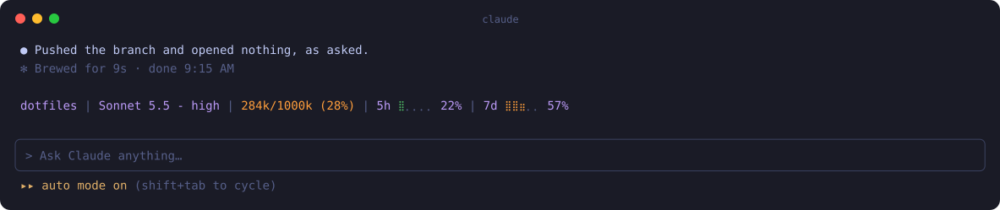

<p align="center"></p>

<h1 align="center">glance</h1>

<p align="center"><i>Everything you check between prompts, in one line above the prompt.</i></p>

<p align="center">
  <a href="https://github.com/ArgonQQ/glance/actions/workflows/ci.yml"></a>
  <a href="https://github.com/ArgonQQ/glance/releases"></a>
  <a href="LICENSE"></a>
  
  
  
</p>

<p align="center"></p>

Which project am I in? Which model, at what effort? How full is the context? How much of my plan
is left, and when does it come back? glance answers all of it in one band right above the prompt,
so you stop typing `/context` and `/usage` between every other message.

## Install

In Claude Code:

```
/plugin install glance --marketplace ArgonQQ/glance
```

Say `y` to add the marketplace and press Enter for the user scope. That's it: no `settings.json`
edits, no shell script, no `jq`.

## What you see

```
📁 my-app | ⚙️ Opus 5.5 - medium | 127k/1000k (13%) | 5h ⣤⡀⡀⡀⡀ 12% ↺ resets in 2 hr 47 min | 7d ⣿⣿⡀⡀⡀ 41% ↺ resets Thu 29 Oct 15:00
```

| Part | Shows |
| --- | --- |
| 📁 `my-app` | The project folder the session runs in. |
| ⚙️ `Opus 5.5 - medium` | The model and effort the last request actually used. Before your first message: what settings configure. |
| `127k/1000k (13%)` | Context used. Green, orange above 20%, red above 35% (both configurable). |
| `5h ⣤⡀⡀⡀⡀ 12%` | Your 5-hour plan window as a 20-step braille meter. Orange from 50%, red from 80%. |
| `↺ resets in 2 hr 47 min` | Countdown to the 5-hour reset. |
| `7d ⣿⣿⡀⡀⡀ 41%` | Your weekly window, same meter. |
| `↺ resets Thu 29 Oct 15:00` | The exact local day and time the weekly window resets. |

It turns orange and red as you burn through a long session:

<p align="center"></p>

Or strip it down: no icons, no reset times, your own colour:

<p align="center"></p>

**Costs zero tokens.** glance reads the same figures Claude Code hands its status line and never
talks to the model.

## Configure

`/config` → `glance`. Every option applies on the spot.

| Option | Default | What it does |
| --- | --- | --- |
| Context orange above (%) | `20` | Context use above this percentage turns orange. |
| Context red above (%) | `35` | Context use above this percentage turns red. |
| Text colour | `#8aa4c8` | Colour of the plain text, so the band never reads like Claude's own output. A hex code or a theme colour name (`subtle`, `suggestion`, ...). |
| Folder icon | `📁` | Shown before the project folder. Empty hides it. |
| Model icon | `⚙️` | Shown before the model. Empty hides it. |
| Show 5h reset countdown | on | The `↺ resets in 2 hr 47 min` after the 5-hour meter. |
| Show weekly reset time | on | The `↺ resets Thu 29 Oct 15:00` after the weekly meter. |

The 5h and 7d parts appear only on a Claude subscription, and only after the first response
reports them.

## Releases

Every merge to `main` that touches the plugin cuts a release with
[semantic-release](https://semantic-release.gitbook.io/), driven by
[Conventional Commits](https://www.conventionalcommits.org/):

| Commit | Release |
| --- | --- |
| `fix: ...` | patch, `1.0.0` → `1.0.1` |
| `feat: ...` | minor, `1.0.0` → `1.1.0` |
| `feat!: ...` or a `BREAKING CHANGE:` footer | major, `1.0.0` → `2.0.0` |
| `docs:`, `chore:`, `ci:`, `test:`, `refactor:`, `style:`, `build:` | none |

The workflow tags `vX.Y.Z`, publishes release notes and commits the version into
`.claude-plugin/plugin.json`, which is what makes `/plugin` offer the update.

## Develop

```
claude --plugin-dir .        # run a session with your working copy
claude plugin validate .
claude plugin test .
```

Installed from a local folder (`claude plugin marketplace add <folder>`), edits apply after
`/reload-plugins`.

## License

[MIT](LICENSE)
